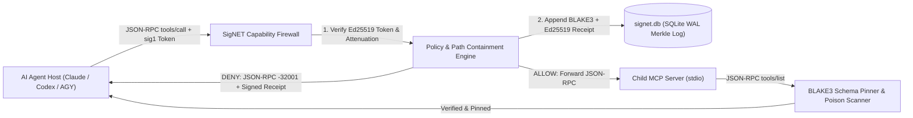

# Sig**NET** Architecture Specification

## 1. Threat Model & System Overview

**Sig**[**NET**] (*Signal + NET*) closes the four primary cryptographic and authorization gaps in Model Context Protocol (MCP) and multi-agent architectures:

---

## 2. Cryptographic Key Hierarchy & Authority Vault (`src/crypto/mod.rs`)

1. **Passphrase KDF (`Argon2id` + `HKDF-SHA256`):** Derives a 256-bit `aead_key` (`signet-v1-vault-aead-key`) and a 256-bit `verifier` (`signet-v1-key-verifier`) from the operator passphrase and a 128-bit CSPRNG salt.
2. **Envelope-Encrypted `Ed25519` Signing Key:** The 32-byte RFC 8032 `Ed25519` secret key is encrypted with `XChaCha20-Poly1305` (192-bit random nonce) bound to contextual AAD `signet-v1|authority-signing-key`.

---

## 3. Monotonic Capability Attenuation (`src/crypto/token.rs`)

A `SigNET` token is encoded as `sig1.<base64url(CapabilityClaims)>.<hex(Ed25519Signature)>`. When `attenuate_capability_token` derives a child token from a verified parent token $T_p$:
- $\text{allow\_tools}_{\text{child}} \subseteq \text{allow\_tools}_{\text{parent}}$
- $\text{deny\_tools}_{\text{child}} \supseteq \text{deny\_tools}_{\text{parent}}$
- Every $p_c \in \text{allowed\_paths}_{\text{child}}$ must be a canonical sub-prefix of some $p_p \in \text{allowed\_paths}_{\text{parent}}$
- $\text{max\_calls\_per\_minute}_{\text{child}} \le \text{max\_calls\_per\_minute}_{\text{parent}}$
- $\text{expires\_at\_unix}_{\text{child}} \le \text{expires\_at\_unix}_{\text{parent}}$
- `parent_token_hash` commits to $\text{BLAKE3}(T_p)$ for full delegation-chain provenance.

---

## 4. Append-Only `BLAKE3` Merkle Transparency Log (`src/ledger/mod.rs`)

Every firewall evaluation (`ALLOW` or `DENY`) appends sequence $n$ to `merkle_audit_log`:

$$H_n = \text{BLAKE3}_{\text{domain}}\left(n \parallel \text{ts}_n \parallel \text{sub}_n \parallel \text{tok}_n \parallel \text{tool}_n \parallel \text{BLAKE3}(\text{args}_n) \parallel \text{dec}_n \parallel \text{reason}_n \parallel H_{n-1}\right)$$

$$\sigma_n = \text{Ed25519\_Sign}_{sk_{\text{auth}}}(H_n)$$

Calling `signet audit` recomputes $H_1 \dots H_N$ from `GENESIS` (`0000...0000`) and verifies $\sigma_1 \dots \sigma_N$ against the authority public key $pk_{\text{auth}}$.
